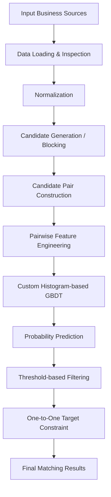

# Amazon ML Challenge 2026 — Business Entity Resolution

<p align="center">
  <strong>Scalable Entity Matching · Multi-Stage Candidate Generation · Custom Gradient Boosting</strong>
</p>

<p align="center">
  
  
  
  
</p>

<p align="center">
  <em>Identifying the same real-world businesses across noisy, inconsistent and independently maintained data sources.</em>
</p>

---

## Overview

Business Entity Resolution is the task of identifying records that refer to the same real-world entity across different datasets, even when their names, addresses, identifiers and other attributes differ.

This repository contains our solution for the **Business Entity Resolution Challenge** in the Amazon ML Challenge 2026.

The objective was to match businesses from a reference source against records in two other sources. The challenge involved dealing with inconsistent business names, incomplete information, formatting variations, noisy addresses and a large candidate search space.

Our approach combines:

- Multi-channel candidate generation and blocking.
- Text normalization and similarity-based matching.
- Pairwise feature engineering.
- A custom histogram-based Gradient Boosting Decision Tree (GBDT) implementation using Numba.
- Leakage-safe validation and threshold-based prediction.

The emphasis was on building a scalable matching pipeline while maintaining strong precision and recall.

## Results at a Glance

| Metric | Result |
|---|---:|
| Local validation macro F0.5 | **0.962847** |
| Validation blocking recall | **98.214%** |
| Pairwise matching features | **50** |
| GBDT estimators | **300** |
| Maximum tree depth | **6** |
| Learning rate | **0.1** |
| Final matching threshold | **0.69** |
| Final test candidate pairs | **126,274,337** |
| Final predicted matches | **5,503,470** |
| Source 1 records without a predicted match | **110,945** |

> **Important:** The validation F0.5 score is from our local held-out validation process. It should not be interpreted as the public leaderboard score. Our public leaderboard result was approximately **0.924**.

---

## Problem Statement

Given three business data sources:

- **Source 1:** Reference dataset containing the businesses to be matched.
- **Source 2:** First target dataset.
- **Source 3:** Second target dataset.

For each business in Source 1, the task is to identify its corresponding records in the target sources.

The difficulty comes from the fact that the same business may appear differently across sources.

For example:

| Attribute | Source 1 | Source 2 |
|---|---|---|
| Business name | ABC Technologies Pvt. Ltd. | ABC Technology |
| Address | 12 MG Road, Bengaluru | 12, Mahatma Gandhi Rd |
| Phone | 9876543210 | +91 98765 43210 |

A direct equality comparison would fail to identify this as a match. The system therefore needs to combine multiple signals to estimate whether two records represent the same business.

The evaluation metric is **Macro F0.5**, which places greater emphasis on precision than recall.

---

## Solution Architecture

Our pipeline follows a multi-stage entity resolution approach.



### 1. Data Preparation and Normalization

The first stage prepares business records for comparison.

It handles variations in textual attributes and standardizes information used by downstream matching components.

Key considerations include:

- Business name normalization.
- Address normalization.
- Identifier and field handling.
- Consistent representations for matching operations.

### 2. Candidate Generation and Blocking

Comparing every Source 1 record against every target record would be computationally expensive.

Instead, we use a multi-channel blocking strategy to generate a smaller set of potentially matching record pairs.

The candidate generation system combines **16 exact-key joins and 2 TF-IDF retrieval channels**.

Different blocking channels capture different types of similarity. Combining them improves the probability of retrieving true matches without requiring exhaustive pairwise comparisons.

Candidate generation is especially important because a true match that is never retrieved cannot be recovered by the downstream machine learning model.

### 3. Pairwise Feature Engineering

For each candidate pair, the system constructs **50 pairwise features** that describe the similarity and compatibility between the two business records.

These features provide the matching model with signals beyond exact textual equality.

The resulting feature representation is used to estimate whether a candidate pair refers to the same business.

### 4. Custom Gradient Boosting Model

We implemented a custom histogram-based Gradient Boosting Decision Tree model using **Numba**.

The model configuration used in the final matching approach:

| Parameter | Configuration |
|---|---:|
| Number of trees | 300 |
| Maximum depth | 6 |
| Learning rate | 0.1 |
| Implementation | Custom histogram-based GBDT |
| Acceleration | Numba |

The model predicts a matching probability for each candidate pair.

This implementation avoids depending on prebuilt LightGBM or XGBoost estimators.

### 5. Prediction and Matching Constraints

The predicted probabilities are converted into final matching decisions using a threshold of **0.69**.

The final prediction stage also applies a one-Source-1-per-target constraint to avoid assigning the same target record to multiple reference records.

---

## Validation Strategy

A leakage-safe validation setup was implemented to evaluate the matching pipeline.

The validation process uses an **80/20 split at the Source 1 entity level**.

This ensures that records belonging to the same reference entity do not leak across training and validation partitions.

The evaluation process includes:

- Candidate generation and blocking evaluation.
- Pairwise matching model evaluation.
- Macro F0.5 scoring.
- Comparison of model configurations.
- Diagnostic experiments to identify matching errors and generalization issues.

### Model Comparison

| Model | Local validation macro F0.5 |
|---|---:|
| Logistic Regression | 0.944584 |
| Custom GBDT | **0.962847** |

The custom GBDT achieved a higher validation score than the Logistic Regression baseline.

---

## Experiments and Diagnostics

The `experiments/` directory contains the analysis and experimentation work carried out during development.

Some of the major areas explored include:

| Area | Purpose |
|---|---|
| Exploratory Data Analysis | Understand data distributions and quality |
| Blocking Experiments | Evaluate candidate generation strategies |
| Matching Experiments | Compare matching approaches |
| Validation Analysis | Verify validation setup and scoring |
| Test-Scale Evaluation | Study pipeline behaviour at larger scale |
| Leave-One-Country-Out Analysis | Examine geographic generalization |
| Threshold Diagnostics | Study decision thresholds |
| Blocking Gap Analysis | Investigate missed candidate matches |
| Error Analysis | Understand false positives and false negatives |
| Feature Ablation | Evaluate the contribution of feature groups |

Detailed reports are available alongside the corresponding experiments.

---

## Repository Structure

```text
Amazon-ML-Challenge-2026/
│
├── docs/
│   ├── COMPETITION_NOTES.md
│   ├── PROBLEM_STATEMENT.md
│   └── TEAM_CONTEXT.html
│
├── src/
│   ├── ber/
│   │   ├── blocking.py
│   │   ├── blocking_eval.py
│   │   ├── features.py
│   │   ├── gbdt.py
│   │   ├── ids_tsv.py
│   │   ├── match_features.py
│   │   ├── matcher.py
│   │   ├── metrics.py
│   │   ├── normalize.py
│   │   └── validation_split.py
│   │
│   ├── tests/
│   ├── build_validation_split.py
│   ├── generate_candidates.py
│   └── score.py
│
├── experiments/
│   ├── blocking/
│   ├── diagnostics/
│   ├── final/
│   ├── matching/
│   ├── validation_split/
│   ├── blocking_experiment.py
│   ├── eda.py
│   ├── final_pipeline.py
│   ├── matching_experiment.py
│   └── ...
│
├── final_submission/
│   └── code/
│       └── business_entity_resolution/
│           ├── README.md
│           ├── requirements.txt
│           └── ...
│
├── utils/
│   └── validate_submission.py
│
├── .gitignore
└── README.md
```

*The structure above highlights the main project components; individual experiment and submission files are omitted for readability.*

---

## Tech Stack

| Technology | Role |
|---|---|
| Python | Core implementation |
| NumPy | Numerical computation |
| Numba | JIT compilation and model acceleration |
| SciPy | Scientific computing |
| TF-IDF | Text-based candidate retrieval |
| Git & GitHub | Version control and collaboration |

---

## Getting Started

### Prerequisites

- Python 3.11.9
- pip
- Git

The final submission package documents the tested dependency versions.

### Clone the Repository

```bash
git clone https://github.com/kasheeesh08/Amazon-ML-Challenge-2026.git

cd Amazon-ML-Challenge-2026
```

### Create a Virtual Environment

**Windows PowerShell**

```powershell
python -m venv .venv

.\.venv\Scripts\Activate.ps1
```

**Linux / macOS**

```bash
python3 -m venv .venv

source .venv/bin/activate
```

### Install Dependencies

For the final submission environment:

```bash
pip install -r final_submission/code/business_entity_resolution/requirements.txt
```

For development and experiments, use the relevant project dependency configuration where available.

### Dataset Setup

The competition datasets are not included in this repository because of their size and distribution restrictions.

Place the competition-provided files in the expected local dataset directory and follow the instructions in the final submission documentation.

**Note:** Dataset files and generated outputs are intentionally excluded from Git.

---

## Reproducibility and Submission

The `final_submission/` directory contains the clean submission package, including its implementation, configuration and documentation.

For detailed instructions on:

- Environment setup.
- Expected input files.
- Pipeline execution.
- Output generation.
- Dependencies and reproducibility.

Refer to:

**[`final_submission/code/business_entity_resolution/README.md`](final_submission/code/business_entity_resolution/README.md)**

The repository also includes a submission validation utility:

```text
utils/validate_submission.py
```

---

## Engineering Considerations

A few design decisions were particularly important during this challenge:

**Candidate recall matters.** A matching model cannot recover a true pair that candidate generation failed to retrieve.

**Precision matters.** Macro F0.5 rewards precision more heavily, making threshold selection and false-positive control important.

**Validation must avoid leakage.** Splitting by reference entity helps prevent overly optimistic validation results.

**Scale changes the problem.** A pipeline that works on a small sample must also be evaluated for memory use, candidate volume and computational cost.

**Diagnostics are part of model development.** Blocking-gap analysis, threshold experiments and error analysis help identify weaknesses that a single aggregate score can hide.

---

## Team

**Team:** camelcase


---

## Acknowledgements

Developed as part of the **Amazon ML Challenge 2026**.

The project reflects our work on large-scale business entity resolution, candidate retrieval, feature engineering, custom machine learning implementation and systematic experimentation.

---

<p align="center">
  <strong>Built with Python, experimentation and a focus on scalable entity matching.</strong>
</p>
